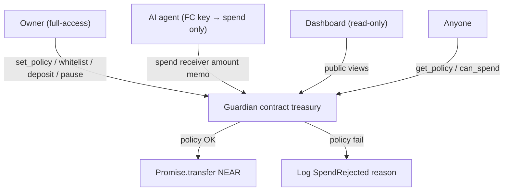

# Bound

**Autonomy, within bounds.**

**Give agents a budget, not a blank check — enforced on-chain, verifiable by anyone.**

**Repository:** https://github.com/xzLawliet/Bound
**Public dashboard:** https://xzlawliet.github.io/Bound/ (GitHub Pages path `/Bound/`, after a maintainer enables Pages on the `gh-pages` branch)

AI agents on NEAR need to spend money. Giving them a full-access key is reckless; opaque off-chain policy is hard to audit. **Bound** keeps the treasury in a contract and lets agents call only `spend`, with **public** limits and whitelist enforced atomically every time.

**Hackathon tracks:** `security` · `agents`
**Event:** [NEAR HACKATHON](https://nearhackathon.com/) (submit by **14 Nov 2026, 23:59 UTC**)

> Honest claim: this is **not** “more secure than OutLayer.” OutLayer isolates keys in TEE. We make **budgets transparent and exact** for open treasuries, DAOs, and builders who want policy anyone can verify on-chain.

---

## Problem

1. Agent wallets without limits can be drained by a buggy or prompt-injected agent.
2. NEAR’s Function Call access keys **cannot** transfer NEAR — perfect for scoping agents to a policy contract — but few demos ship the full pattern.
3. TEE custody (e.g. OutLayer) is excellent for production key isolation; open / composable on-chain budget accounting is still a gap.

## Differentiation vs OutLayer

| | **OutLayer** | **Bound** |
|---|---|---|
| Agent key material | No chain key (API → TEE signs) | Function Call key scoped to `spend` only |
| Policy visibility | Encrypted; evaluated in TEE | **Public on-chain** (`get_policy`) |
| Daily / velocity limits | Best-effort under concurrency | **Exact** — `spent_today` + day bucket, atomic |
| Trust model | Hardware attestation + operator infra | Contract code + NEAR consensus |
| Integration | Custody / API product | **Composable** — any account with FC key can call |
| Best fit | Production multi-chain custody | Open treasuries, hackathon agents, auditable demos |

Complementary, not competitive: OutLayer isolates keys; Bound makes budgets verifiable.

---

## Architecture



```
Owner (full access)
  └─ deploy guardian + set_policy + deposit + whitelist
Agent (FC Key → guardian::spend only)
  └─ propose payments to vendors
Guardian contract
  └─ whitelist → max_per_tx → daily remaining → transfer | reject + log
```

**Out of scope for this MVP:** TEE, encrypted policy, NEAR Intents settlement (future: `spend_via_intent`), multisig DAO, multi-chain signing.

---

## Repo layout

```
contracts/agent-guardian/   # Rust near-sdk contract + unit tests
scripts/                    # Live testnet agent + negative proof
frontend/                   # Live NEAR testnet dashboard (owner wallet controls next)
HACKATHON.md                # Submit checklist + demo script
```

---

## Build & test

### Prerequisites

- Rust **1.88+** (repo includes `rust-toolchain.toml`; `rustup` will auto-select)
- `cargo`
- Node >=22.22.2 for the testnet demo script (near-api-js 7.4)

### Contract unit tests

```bash
cd contracts/agent-guardian
cargo test
```

### Build WASM (when ready to deploy)

```bash
cd contracts/agent-guardian
rustup target add wasm32-unknown-unknown
cargo build --release --target wasm32-unknown-unknown
# artifact: target/wasm32-unknown-unknown/release/agent_guardian.wasm
```

> **Dependency note:** `Cargo.toml` pins `near-sdk` via **git tag `near-sdk-v5.17.2`** so this environment can fetch when crates.io API is flaky. On a normal network you may switch to `near-sdk = "5.17.2"` (or current 5.x) with `features = ["unit-testing"]` in `[dev-dependencies]`.

---


## Verified testnet proof

Guardian: [`guardian.bound-aoyamari.testnet`](https://explorer.testnet.near.org/accounts/guardian.bound-aoyamari.testnet). Initially funded with 5 testnet NEAR; max **0.25 NEAR/payment**, **0.5 NEAR/day**; whitelisted vendor `vendor.bound-aoyamari.testnet`.

The agent's only key is allowed to call `spend`; the bootstrap full-access key was removed. All facts and setup details: [`DEV.md`](DEV.md).

| Verification | On-chain result | Transaction |
|---|---|---|
| Whitelisted payment of 0.1 NEAR | `SpendAllowed` | [Open](https://explorer.testnet.near.org/transactions/3pNHTmanHQ8gPtnQNVeCLt7k4YuemMYNc9aTL6NtYoqR) |
| 0.3 NEAR exceeds cap | `SpendRejected: over_max_per_tx` | [Open](https://explorer.testnet.near.org/transactions/B8p9RA7zqgARfrJ6g1k1mrPP1Mx63urtPfJ3po6V1Z4x) |
| Unwhitelisted receiver | `SpendRejected: not_whitelisted` | [Open](https://explorer.testnet.near.org/transactions/CbaJYocRDNseff9iAtpchbtD8o6pcy6WvHQxssL3Mbn9) |

Those receipts, and the later allowed payment that filled the UTC day to 0.5 NEAR, are the first bytecode. The account was then upgraded in place (`without-init-call`) from main `9e585567f69163f1e9bbbc4d53e35e9a9901983c`; current code hash and the preserved policy are in [`DEV.md`](DEV.md). No new positive payment has been made on the upgraded wasm: the 2026-11-06 daily cap is already 0.5 / 0.5. The negative direct-transfer test is rejected as `RequiresFullAccess` (SDK v7: `AccessKeyRequiresFullAccessActionError`).

### Live policy read

```bash
near contract call-function as-read-only guardian.bound-aoyamari.testnet get_policy json-args '{}' network-config testnet now
near account list-keys agent.bound-aoyamari.testnet network-config testnet now
```

Install with `npm install -g near-cli-rs@latest`; contract needs Rust 1.88+. Run `cargo test --manifest-path contracts/agent-guardian/Cargo.toml` and follow `DEV.md` for live parameters. `docs/DEPLOY.md` separates the first wasm (path-sensitive rebuild of `469b74b`–`31ab724`) from the current upgrade hash. Dashboard source lives in `frontend/` and publishes to the static `gh-pages` branch of https://github.com/xzLawliet/Bound. The expected project Pages URL is https://xzlawliet.github.io/Bound/. Enabling Pages is a separate maintainer step. The read-only dashboard fetches `get_policy` and `can_spend`; scenario cards are dry-run views, **not payments**. Owner controls are implemented through NEAR CLI only; no browser wallet or production deploy yet.

## Do X → see Y (AI screener / judges)

1. **Deploy & init** on testnet with `max_per_tx` / `daily_limit` in yoctoNEAR.
2. **Owner** calls `add_to_whitelist(vendor.testnet)` and deposits NEAR (`deposit` with attached deposit, or transfer to contract).
3. **Add FC key** on the agent account: only `guardian.testnet` / method `spend` (no `transfer` permission — FC keys cannot transfer NEAR anyway).
4. **Run allowed spend** → explorer log contains `SpendAllowed`; vendor balance increases.
5. **Run over `max_per_tx`** → `SpendRejected` / `over_max_per_tx`; `spent_today` unchanged.
6. **Run non-whitelist receiver** → `SpendRejected` / `not_whitelisted`.
7. **Prove FC key cannot native-transfer** → same key fails a direct NEAR transfer (protocol-level).
8. **View** `get_policy` / `can_spend` — policy is public.

Detailed submit notes: [`HACKATHON.md`](./HACKATHON.md).

---

## Policy rules (MVP)

On every `spend(receiver, amount, memo)`:

1. Not `paused`
2. `receiver` ∈ whitelist
3. `amount ≤ max_per_tx`
4. `spent_today + amount ≤ daily_limit` (after rolling UTC day bucket)
5. Spendable balance ≥ `amount`. Spendable balance is `account_balance` minus the storage reserve (`storage_usage * storage_byte_cost`). Validator `account_locked_balance` is not part of `account_balance`.
6. Then transfer + bump `spent_today`

Day bucket: `floor(block_timestamp_ns / 86_400_000_000_000)`. `get_spent_today`, `get_day_bucket`, and `can_spend` use the current bucket immediately. Stored `spent_today` resets on the next `spend` or `set_policy`.

`deposit` is a permissionless payable credit. A plain NEAR transfer to the contract account also adds to the treasury. Admin writes and `withdraw` require the predecessor to be the owner. `withdraw` ignores pause and the agent caps. `spend` applies the same policy to every caller; a Function Call key scoped to `spend` is configured on the agent account, not inside this contract.

---

## License

MIT — see [`LICENSE`](./LICENSE).
