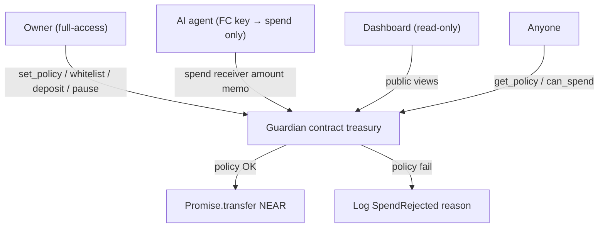

# Bound

**Autonomy, within bounds.**

**Give agents a budget, not a blank check — enforced on-chain, verifiable by anyone.**

**Repository:** https://github.com/xzLawliet/Bound
**Live dashboard:** https://xzlawliet.github.io/Bound/

AI agents on NEAR need to spend money. Giving them a full-access key is reckless; opaque off-chain policy is hard to audit. **Bound** keeps the treasury in a contract and lets agents call only `spend`, with **public** limits and whitelist enforced atomically every time.

**Hackathon tracks:** `security` · `agents`
**Event:** [NEAR HACKATHON](https://nearhackathon.com/) (submit by **14 Nov 2026, 23:59 UTC**)

> Honest claim: this is **not** “more secure than OutLayer.” OutLayer isolates keys in TEE. We make **budgets transparent and exact** for open treasuries, DAOs, and builders who want policy anyone can verify on-chain.

---

## Problem

1. Agent wallets without limits can be drained by a buggy or prompt-injected agent.
2. NEAR’s Function Call access keys **cannot** transfer NEAR — perfect for scoping agents to a policy contract — but few demos ship the full pattern.
3. TEE custody (e.g. OutLayer) is excellent for production key isolation; open / composable on-chain budget accounting is still a gap.

## Differentiation vs OutLayer

| | **OutLayer** | **Bound** |
|---|---|---|
| Agent key material | No chain key (API → TEE signs) | Function Call key scoped to `spend` only |
| Policy visibility | Encrypted; evaluated in TEE | **Public on-chain** (`get_policy`) |
| Daily / velocity limits | Best-effort under concurrency | **Exact** — `spent_today` + day bucket, atomic |
| Trust model | Hardware attestation + operator infra | Contract code + NEAR consensus |
| Integration | Custody / API product | **Composable** — any account with FC key can call |
| Best fit | Production multi-chain custody | Open treasuries, hackathon agents, auditable demos |

Complementary, not competitive: OutLayer isolates keys; Bound makes budgets verifiable.

---

## Architecture



```
Owner (full access)
  └─ deploy guardian + set_policy + deposit + whitelist
Agent (FC Key → guardian::spend only)
  └─ propose payments to vendors
Guardian contract
  └─ whitelist → max_per_tx → daily remaining → transfer | reject + log
```

**Out of scope for this MVP:** TEE, encrypted policy, NEAR Intents settlement (future: `spend_via_intent`), multisig DAO, multi-chain signing.

---

## Repo layout

```
contracts/agent-guardian/   # Rust near-sdk contract + unit tests
scripts/                    # Live testnet agent + negative proof
frontend/                   # Live NEAR testnet dashboard (owner wallet controls next)
HACKATHON.md                # Submit checklist + demo script
```

---

## Build & test

### Prerequisites

- Rust **1.88+** (repo includes `rust-toolchain.toml`; `rustup` will auto-select)
- `cargo`
- Node >=22.22.2 for the testnet demo script (near-api-js 7.4)

### Contract unit tests

```bash
cd contracts/agent-guardian
cargo test
```

### Build WASM (when ready to deploy)

```bash
cd contracts/agent-guardian
rustup target add wasm32-unknown-unknown
cargo build --release --target wasm32-unknown-unknown
# artifact: target/wasm32-unknown-unknown/release/agent_guardian.wasm
```

> **Dependency note:** `Cargo.toml` pins `near-sdk` via **git tag `near-sdk-v5.17.2`** so this environment can fetch when crates.io API is flaky. On a normal network you may switch to `near-sdk = "5.17.2"` (or current 5.x) with `features = ["unit-testing"]` in `[dev-dependencies]`.

---


## Live proof (2026-11-06)

Owner `xzlawliet.testnet`. Guardian [`guardian.xzlawliet.testnet`](https://explorer.testnet.near.org/accounts/guardian.xzlawliet.testnet). Agent `agent2.xzlawliet.testnet`. Vendor `vendor.xzlawliet.testnet`. Unknown receiver `near-examples.testnet`. Policy: max **0.25 NEAR**, daily **0.5 NEAR**, unpaused at the end of the run. `spent_today` was exactly **0.1 NEAR**.

| Step | Result | Transaction |
|---|---|---|
| Deploy and init | Wasm SHA256 `d8a46cdd310339fb0c9654eacdc7879894e0663038a64039e684b1d72d733110`, source `9e58556` | [C4ECGqdc…](https://explorer.testnet.near.org/transactions/C4ECGqdcki9YV9ZZUbTdzuFYoyNH48poWXSna4NGTQ9y) |
| Whitelist | `vendor.xzlawliet.testnet` added by `xzlawliet.testnet` | [BL1QBjbx…](https://explorer.testnet.near.org/transactions/BL1QBjbxW13tiXj2RyM2PWCz7GaEVsCxxB5hcPdbaE5B) |
| Create agent2 | Second limited account | [F9LXENTG…](https://explorer.testnet.near.org/transactions/F9LXENTGCouNQxDabduV5Wob8MzbnbwS1qM2PwBAsHQa) |
| Function-call key | `ed25519:AjkYUs1vp7MvfwJmXHs1vaYfYcMT7uEK6EhLU5uksE2c`, method `spend` only, receiver `guardian.xzlawliet.testnet`, initial gas allowance exactly 0.25 NEAR | [FTVzRfsj…](https://explorer.testnet.near.org/transactions/FTVzRfsjWK1x4UMVDEVpAXUhRDewRRBf69GpDPgWwNrH) |
| Remove bootstrap | Full-access key deleted after the function-call key | [3b77Pr5x…](https://explorer.testnet.near.org/transactions/3b77Pr5xeonRQnWULnzsDn56xDcZAu5PqE5zzPWnxUBS) |
| Allowed 0.1 NEAR | `SpendAllowed` to `vendor.xzlawliet.testnet` | [CmDoLMHx…](https://explorer.testnet.near.org/transactions/CmDoLMHxw6of9qPLZc1RntH3ZuQS4uuh7mMDuG1mR6qZ) |
| Over max 0.3 NEAR | Rejected | [GSJ6Jd6q…](https://explorer.testnet.near.org/transactions/GSJ6Jd6q6oGfjw91a6nQoTRcerxvJ48JJeYXvhHkg1Cc) |
| `near-examples.testnet` 0.1 NEAR | Rejected, not whitelisted | [HGtfkbpY…](https://explorer.testnet.near.org/transactions/HGtfkbpYV99BTVB77eRKU3SbRWaBQKoj75NoLXwedexR) |
| Native transfer | Blocked `AccessKeyRequiresFullAccessActionError` | No successful transfer |
| Pause | Owner pause | [BKH74dMT…](https://explorer.testnet.near.org/transactions/BKH74dMTfo76QXQrrAiA4G8N89kqfQ9FHV89yxEsWLjc) |
| Spend while paused | Rejected | [Ffj9zMx2…](https://explorer.testnet.near.org/transactions/Ffj9zMx2DXdJFnXLHtXwVYV75d7tVfUemrEyoVA1BQsW) |
| Unpause | Guardian left unpaused | [5zFyRDCH…](https://explorer.testnet.near.org/transactions/5zFyRDCHbByoPwL11soDg6cNoTCP8v2cZDsGofr93ZpR) |

The 0.25 NEAR on the function-call key is the near-api-js default gas budget, set by omitting an allowance. It is not full access and it is not the treasury cap. After this run the remaining gas allowance was about 0.2492 NEAR. The private key stays local. Owner account creation, not a deploy: [`HCTPTiMUQhCzHKLKYKspcz7aTgSjwgxspSpq7sDbVEAA`](https://explorer.testnet.near.org/transactions/HCTPTiMUQhCzHKLKYKspcz7aTgSjwgxspSpq7sDbVEAA) (10 NEAR).

`agent.xzlawliet.testnet` is an unused first account. Its key had gas allowance 0 and it made no successful payments. The active agent is `agent2.xzlawliet.testnet`.

The deployed wasm is the `9e58556` build. `Cargo.toml` `repository` in this tree is `https://github.com/xzLawliet/Bound`, and that edit was not compiled into the wasm. Legacy old guardian receipts, including that account's 0.5 NEAR day, are in [`DEV.md`](DEV.md). They are not this guardian's balance.

`frontend/src/near.ts` calls `guardian.xzlawliet.testnet`, and the header shows that id in exact case. Scenario rows use `vendor.xzlawliet.testnet` and `near-examples.testnet`. https://xzlawliet.github.io/Bound/ still serves the published bundle, which calls `guardian.bound-aoyamari.testnet`, until a later publish from `main`. This change does not publish Pages.

```bash
near contract call-function as-read-only guardian.xzlawliet.testnet get_policy json-args '{}' network-config testnet now
near account list-keys agent2.xzlawliet.testnet network-config testnet now
```

Install with `npm install -g near-cli-rs@latest`; contract needs Rust 1.88+. Run `cargo test --manifest-path contracts/agent-guardian/Cargo.toml`. Dashboard source lives in `frontend/`. The read-only dashboard fetches `get_policy` and `can_spend`; scenario cards are dry-run views, **not** the payments in the table above. Owner controls are NEAR CLI only.

## Do X → see Y (AI screener / judges)

1. **Deploy & init** on testnet with `max_per_tx` / `daily_limit` in yoctoNEAR.
2. **Owner** calls `add_to_whitelist(vendor.testnet)` and deposits NEAR (`deposit` with attached deposit, or transfer to contract).
3. **Add FC key** on the agent account: only `guardian.testnet` / method `spend` (no `transfer` permission — FC keys cannot transfer NEAR anyway).
4. **Run allowed spend** → explorer log contains `SpendAllowed`; vendor balance increases.
5. **Run over `max_per_tx`** → `SpendRejected` / `over_max_per_tx`; `spent_today` unchanged.
6. **Run non-whitelist receiver** → `SpendRejected` / `not_whitelisted`.
7. **Prove FC key cannot native-transfer** → same key fails a direct NEAR transfer (protocol-level).
8. **View** `get_policy` / `can_spend` — policy is public.

Detailed submit notes: [`HACKATHON.md`](./HACKATHON.md).

---

## Policy rules (MVP)

On every `spend(receiver, amount, memo)`:

1. Not `paused`
2. `receiver` ∈ whitelist
3. `amount ≤ max_per_tx`
4. `spent_today + amount ≤ daily_limit` (after rolling UTC day bucket)
5. Spendable balance ≥ `amount`. Spendable balance is `account_balance` minus the storage reserve (`storage_usage * storage_byte_cost`). Validator `account_locked_balance` is not part of `account_balance`.
6. Then transfer + bump `spent_today`

Day bucket: `floor(block_timestamp_ns / 86_400_000_000_000)`. `get_spent_today`, `get_day_bucket`, and `can_spend` use the current bucket immediately. Stored `spent_today` resets on the next `spend` or `set_policy`.

`deposit` is a permissionless payable credit. A plain NEAR transfer to the contract account also adds to the treasury. Admin writes and `withdraw` require the predecessor to be the owner. `withdraw` ignores pause and the agent caps. `spend` applies the same policy to every caller; a Function Call key scoped to `spend` is configured on the agent account, not inside this contract.

---

## License

MIT — see [`LICENSE`](./LICENSE).
